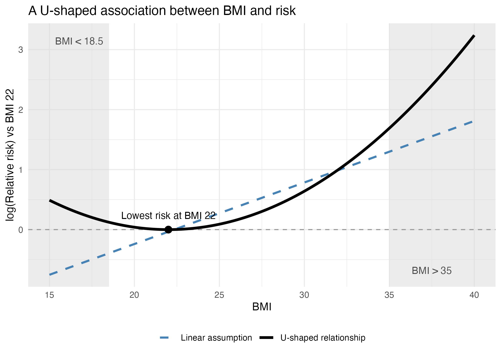
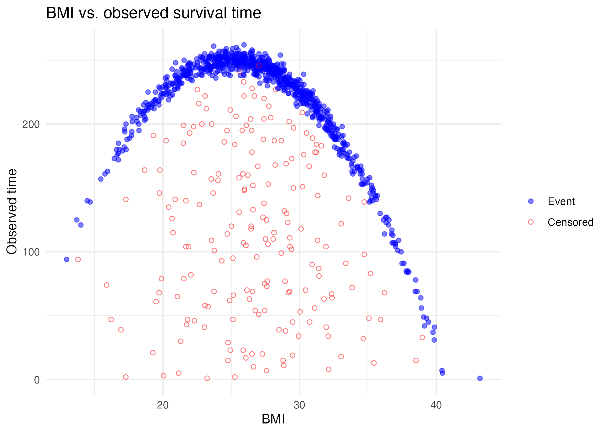
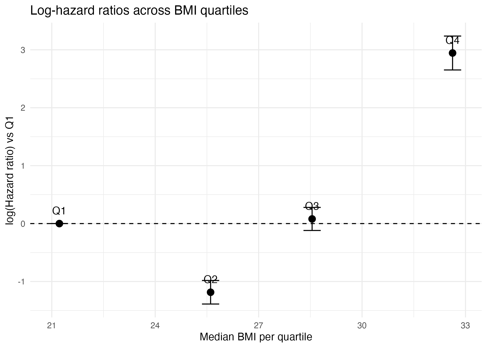
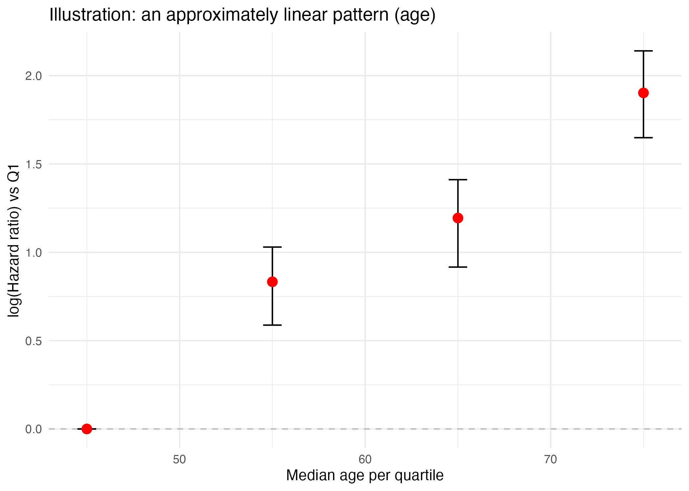
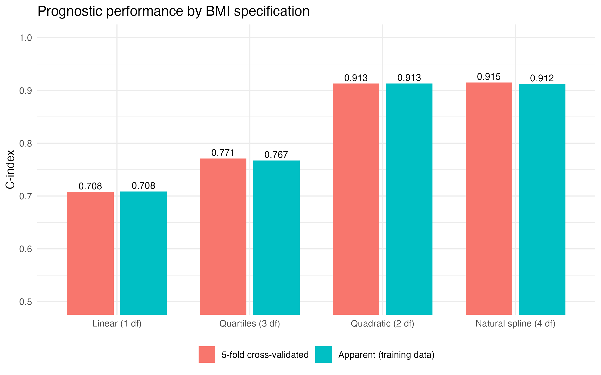
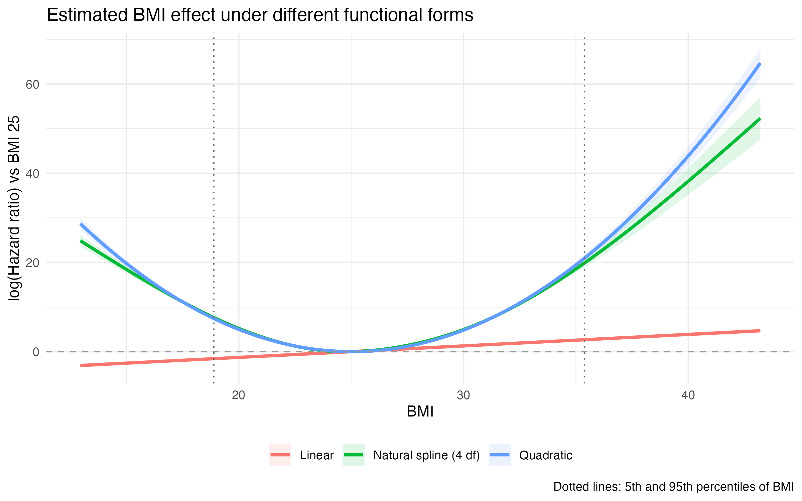
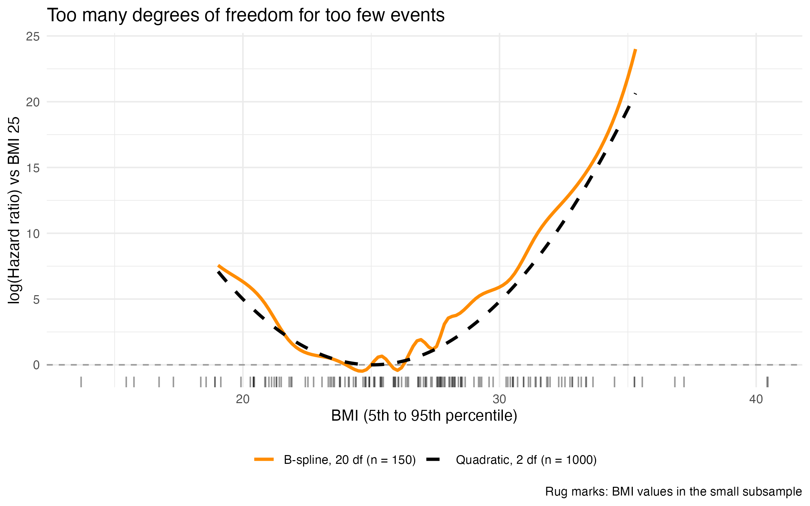

# Understanding Functional Forms in Survival Analysis: Why Linear Isn't Always Enough

*Fan Fan and Jane Liu*

In survival analysis (and regression modeling broadly), one of the most fundamental—but often overlooked—questions is:

> ***"How does a variable relate to the outcome?"***

This is the question of understanding and correctly modeling the ***functional form*** of the covariates with the outcome. Getting it wrong can lead to biased estimates, misleading conclusions, and poor predictions. This post walks through what functional form means, why it matters, and how to evaluate it in practice.

<!-- more -->

## What is Functional Form?

In a [Cox proportional hazards model](https://en.wikipedia.org/wiki/Proportional_hazards_model), the default assumption is simple:

- Each covariate affects the log-hazard linearly.
- A one-unit increase in a variable changes the log-hazard by the magnitude, regardless of the starting value.

For example, imagine we're modeling the effect of BMI on disease risk. The model assumes that every 1-unit increase in BMI changes the log-hazard by the same magnitude (say, 1.05 = a 5% increase), whether BMI rises from 20 to 21 or from 35 to 36. In both cases, the relative risk increase is the same.

But this is a strong assumption—and in reality, isn't always linear. Take BMI and health risk, for instance:

- Both very low and very high BMIs are often associated with higher risk.
- Moderate BMIs may actually be protective of adverse events.

This kind of pattern, where risk increases at both extremes, creates a U-shaped relationship (see Figure 1). Here, "risk" refers to the likelihood or hazard of experiencing the event of interest, such as disease onset, complication or death, during the study period.

**Figure 1.** An example of a U-shaped association between BMI and [insert the outcome]. The risk is lowest at a BMI of 22 and increases as BMI falls below or rises above this point, illustrating how the effect of BMI on risk is not constant across its range.

This U-shaped relationship violates the linearity assumption, and a straight line can't capture such complexity—especially at the extremes of the distribution (i.e., very low BMI such as <18.5, and very high BMI such as >35), where the model may start to significantly underestimate risk.

## Checking Functional Form: From Simple to Flexible

Checking the functional form means assessing whether the assumed relationship between a covariate and the log-hazard (usually linear) actually fits the data. This is crucial because an inappropriate form can bias estimates, obscure true effects, or lead to poor predictions/prognostications. In the sections below, we'll walk through several practical approaches to check functional form using synthetic data. This example code [link] demonstrates how to assess a synthetic continuous variable and how modeling the appropriate functional form can enhance prognostic accuracy.

### Synthetic data generation

To create the synthetic dataset, we first simulate a continuous predictor—body mass index (BMI)—as normally distributed with a mean of 27 and a standard deviation of 5, representing a realistic population spread.

We then define synthetic survival times to follow a U-shaped relationship with BMI: survival is highest around BMI 25 and decreases as BMI deviates from this point, either lower or higher. This is achieved by subtracting the squared difference from 25, i.e., (BMI − 25)², from a fixed maximum survival time and adding a small amount of random noise to introduce variability. To further mimic real-world survival data, we introduce random censoring: approximately 20% of patients are censored, meaning their true event times are unknown beyond a certain follow-up period (e.g. Lost to follow up time). For these patients, a random censoring time is drawn uniformly between 1 and their true survival time. The final observed time is the shorter of the true event time and the censoring time, and patients are flagged as censored if their event was not observed before censoring occurred.

This setup results in a dataset that closely mirrors real-world clinical studies, where both the nonlinear effects of covariates and incomplete follow-up (censoring) are common challenges. Figure 2 illustrates the relationship between BMI and observed survival or censoring times.

**Figure 2.** Relationship between BMI and observed survival time in the synthetic dataset. Each point represents a patient, with filled blue circles indicating observed events and open red circles indicating censored observations. The U-shaped pattern reflects the simulated association between BMI and survival, where survival times are highest near BMI 25 and decline as BMI deviates in either direction. Random censoring was applied to approximately 20% of patients.

### Assessing BMI's Functional Form Using Quartile-Based Cox Models

This is often the first step when exploring a continuous variable:

1. Split the variable into quartiles (or quintiles).
2. Fit a Cox model using the first quartile as a reference.
3. Plot the coefficient estimates (on the log hazard scale) for all four quartiles (use 0 for the first reference quartile) against the median value of each group.

**Interpretation:**

- If coefficient estimate increase/decrease monotonically → linearity may hold.
- If coefficient estimate show curvature (e.g., U-shape) → modeling nonlinear association may be needed.

In the example code, to explore whether BMI follows a linear functional form in the Cox model, we first categorize BMI into quartiles. We then fit a Cox proportional hazards model with these quartile categories as predictors, treating the lowest quartile (Q1) as the reference group, estimating the coefficient estimate for each quartile relative to Q1. Next, we compute the median BMI for each quartile to provide a representative value for plotting. From the Cox model summary, we extract the coefficient estimates and their 95% confidence intervals for each quartile and merge these results with the quartile medians. This produces a clean dataset for visualization, where we can plot the coefficient estimate against the median BMI of each quartile. Such a plot allows us to quickly assess whether the relationship between BMI and survival appears linear, monotonic, or nonlinear (e.g., U-shaped).

Figure 3 (A) reveals a clear nonlinear relationship between BMI and survival risk. Compared to the reference quartile (Q1), HR increases sharply at higher BMI quartiles, while the second quartile shows a slightly reduced risk. The U-shaped pattern is evident when considering both the negative log-hazard ratio in Q2 and the steep rise in Q3 and Q4, highlighting that both low and high BMI values are associated with elevated risk. This suggests that modeling BMI as a linear predictor would miss important nuances in its relationship with survival. In contrast, simulation data in (B) demonstrates a linear relationship between log-HR and age in adults, suggesting that a linear functional form may be appropriate for age when such a pattern is observed.

For further comparison, we also built a model using the raw linear form of BMI. When comparing the two Cox models, we found that modeling BMI using quartiles provided a better fit and improved predictive performance. The quartile-based model has a higher concordance index (C = 0.764 vs. 0.700 shown in Figure 4), suggesting superior prognostication ability. This demonstrates that accounting for the nonlinear relationship between BMI and survival significantly enhances the prognostic performance of the Cox model.

*(A)*

*(B)*

**Figure 3.** (A) Log-hazard ratios and 95% confidence intervals for BMI quartiles from a Cox proportional hazards model. The x-axis represents the median BMI within each quartile, and the y-axis shows the log-transformed hazard ratios relative to the reference group (Q1). Error bars indicate 95% confidence intervals. The dashed horizontal line at zero corresponds to no difference in hazard compared to the reference quartile. This plot helps visualize the functional form of BMI's association on survival. (B) Log-hazard ratios plotted against median age. A linear trend here suggests that modeling age as a raw continuous variable may be appropriate.

**Figure 4.** Prognostic performance of Cox models using four specifications of BMI: linear (1 df), quartiles (3 df), quadratic (2 df) and natural cubic spline (4 df). Bars show the concordance index (C-index) for each model, both on the training data (apparent) and averaged over 5-fold cross-validation, where each model is fit on four-fifths of the data and evaluated on the held-out fifth. The linear model has the lowest discrimination (C = 0.708). Modeling BMI as quartiles improves it (C = 0.767 apparent, 0.771 cross-validated). The quadratic and spline models, which capture the U-shaped relationship directly, perform best (C ≈ 0.91). Apparent and cross-validated values are nearly identical for every model, which indicates little overfitting at this sample size (808 events). A C-index of 0.5 means no better than chance; 1.0 means perfect ranking of patients by risk.

### Exploring Functional Forms with Linear + Quadratic + Spline Terms

For deeper investigation, biostatisticians sometimes also compare:

- **Linear Term:** assumes a straight-line effect.
- **Quadratic Term:** adds a squared term (e.g., BMI²) to allow U-shaped or inverted U-shaped relationships.
- **Cubic Splines:** divide the variable's range into intervals and fit smooth, flexible polynomials joined at "knots."

Compared to the quartile-based approach, these methods can capture more complex relationships between the variable and outcome. However, they are less commonly used in practice due to several limitations, which we will discuss in a later section.

In the example code:

- We create additional transformed features—`bmi^2` for the quadratic term and spline basis terms using the `bs()` function from the `splines` package (degree = 3).
- These transformed variables are added to a new dataset for modeling.
- Two Cox models are then fit:
  - One with only the linear BMI term.
  - Another with linear, quadratic, and spline terms, giving it greater flexibility to learn the true relationship.

This approach introduces 5 degrees of freedom (df)—a measure of how many independent pieces of information the model uses to estimate the effect of BMI.

- A linear term has 1 df because it fits a single slope to describe the relationship.
- Adding a quadratic term contributes another parameter for curvature, bringing it to 2 df.
- The spline-based model, with 3 df specified in the cubic spline, estimates 3 additional parameters to flexibly shape the curve, totaling 5 df.

By increasing df, the model gains flexibility but also requires more observed events to ensure stable estimation and avoid overfitting.

Figure 5 (A) illustrates that the spline-enhanced model captures nonlinear patterns that the simple linear model misses within the 5th ~ 95th percentile range where large samples fall into. Using this complex model, we can deeply understand the relationship between covariate and the HR compared to quantile version (Figure 3 A). However, due to several practical limitations, biostatisticians often prefer the simpler quartile-based model in practice. For models incorporating linear, quadratic, and spline terms, increasing complexity (e.g., splines and polynomials) also increases the df. A common rule of thumb suggests that approximately 10 events per degree of freedom are needed to achieve stable estimation (Peduzzi et al. (1995)). In smaller datasets, this higher complexity may lead to overfitting (Figure 5 (B)). As a result, while spline-based models are excellent for exploratory analysis, simpler functional forms—such as linear or categorical variables—are often preferred in final predictive models because they can reduce the risk of overfitting, require fewer events for stable estimation, and provide results that are easier to interpret.

*(A)*

*(B)*

**Figure 5.** Estimated relationship between BMI and the log-hazard under different functional forms.

**(A)** Log-hazard ratios relative to BMI 25 from three Cox models fitted to the full dataset (n = 1,000; 808 events): a linear term (1 df), a quadratic term (2 df), and a natural cubic spline (4 df). Shaded bands show pointwise 95% confidence intervals. Vertical dotted lines mark the 5th and 95th percentiles of BMI, where most observations lie and estimates are most stable. The horizontal dashed line at zero is no difference in hazard from BMI 25. The quadratic and spline curves agree closely and recover the U-shaped relationship, while the linear term misses it entirely.

**(B)** Overfitting with too many degrees of freedom. The solid orange curve is a B-spline with 20 df, fitted to a random subsample of 150 patients (123 events; about 6 events per df, below the usual guideline of about 10). The dashed black curve is the quadratic model from the full dataset, shown for reference. Curves are plotted within the 5th–95th percentile range of BMI, and rug marks show the BMI values in the subsample. The overly flexible spline follows the general U-shape but adds spurious wiggles driven by noise in the small sample.

## Conclusion

Understanding and correctly specifying the functional form of continuous variables is critical in survival analysis. As we've shown through simulated data, assuming a simple linear relationship can obscure important patterns—like the U-shaped association between BMI and survival risk. While more complex approaches such as splines can capture complex relationships, they come at the cost of increased model complexity and risk of overfitting, especially in smaller datasets. In practice, simpler format like quartile-based models often provide a good balance between interpretability and performance. Ultimately, carefully evaluating functional form not only improves model fit and prognostic accuracy but also leads to insights that are more aligned with real-world clinical phenomena.

## Acknowledgements

We thank Jane Liu for developing the example code that accompanies this post.
